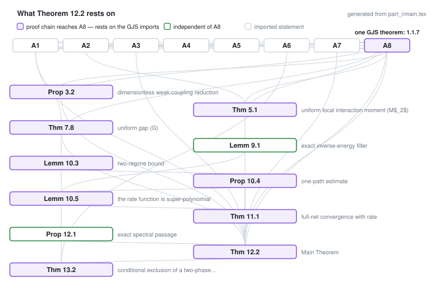
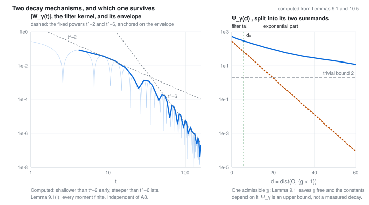
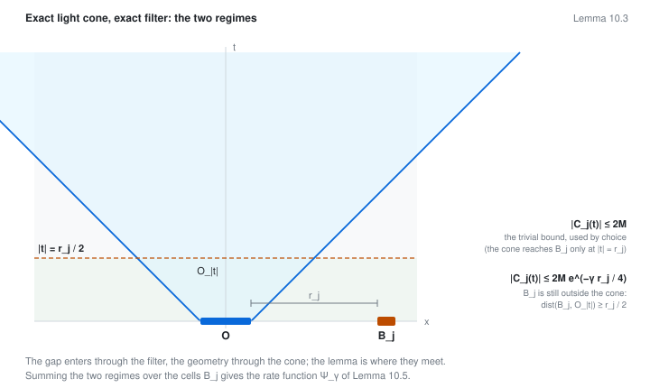
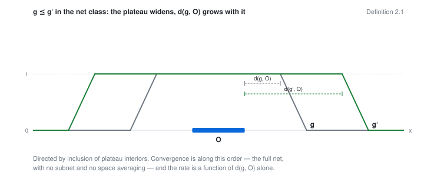
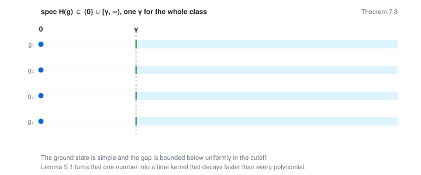

# Removal of the spatial cutoff for weakly coupled P(φ)₂

Manuscript, working notes, and the full adversarial audit trail for a Hamiltonian proof
that the net of spatially cutoff P(φ)₂ ground states converges in norm on every local
algebra. This is a research record, not a published paper.

## What this is: an AI-assisted, experimental open-science project

This repository is an **experiment in open science, and the work in it is AI-assisted.**
The manuscript, the working notes and the audit documents were drafted by the author
working with Anthropic's Claude as an interactive assistant, and the entire working
method — every phase, gate and adversarial round, including the rounds that found errors
in earlier rounds' repairs — is published alongside the result rather than discarded.
That is the experiment: the record of how the proof was arrived at is part of what is
being released.

**Human verification of the output is ongoing.** Nothing here has been refereed, and the
author's own line-by-line check of the machine-assisted material is still in progress:
open audit item C5 (a second human reader for the GJS page images, see below) is
unclosed. Theorem 12.2 is proved from printed statements only, with one GJS theorem imported: Theorem 1.1.7, which is also used for sharp-time observables across strips transverse to the time-zero line, a case its printed statement covers and its printed proof does not reach (listed separately as A8(iv)-T). The uniform local moment is a theorem of the record (Appendix D). The human page readings of audit item C5 (items 1–4 and 10–12, with item 9(c)) are open. Since the version of 11 November 2026, published on 21 November, the free-field layer of the record (its momentum field and free Hamiltonian, and the action of translations, parity and dilations) is defined and proved in Appendix E; an audit of 9 November had found it used without being stated (see Status). Read every
statement in this repository as a claim under active verification, not as a settled
result, and check anything you intend to rely on against the cited sources yourself.
Direction, mathematical judgement and final responsibility are the author's.

## Status: the main theorem is an implication from printed imports. Please read this first.

**The free-field layer: found on 9 November 2026, repaired on 11 November, published on 21 November.** A fresh audit on
9 November (round V4f, `ugjs/council/v4f-free-field-report.md`) found that `part_i/main.tex`
used four standard properties of the free field that it neither defined, derived nor imported:

1. the time-zero momentum field π₀ and the free Hamiltonian H₀ on Q-space, which were named
   and never defined;
2. the space translations as automorphisms of the algebra, which Theorem 12.2(4),
   Corollary 12.3 and Theorem 13.2 use, and their action on the net, τ_a(A(O)) = A(O + a),
   used in the proofs of Theorem 12.2(4) and Theorem 13.2;
3. the parity relation Θπ₀(h)Θ = −π₀(h), used in the proof of Theorem 12.2(4) and through it
   in Theorem 13.2;
4. the dilation unitary of Remark 3.3, on which the reduction to the source's mass rests.

No step was found to be false, and all four gaps were older than the integration of
7 November. From 11 to 21 November the public pages carried a notice that Theorem 12.2
was proved conditional on these four items (commit d2b106c). The record now has an Appendix E.
It defines the objects through the unitary between Fock space and Q-space of Simon's
Theorem I.11, proves how translations, parity and dilations act on the fields, on the local
algebras, on H₀ and on the interaction V(g), and, except for the dilation unitary, which has no
counterpart in the sources, identifies the objects with those of GJ2 (for GJ71 and Rosen70 a
declared reading since 23 November 2026). The printed statements it uses are listed in Assumption A1, whose items
(e)–(g) are new. Two fresh agents audited the repair on 11 November (round V5: one the
mathematics, one the sources and the integration). They found no critical error and three
major points: Remark 3.3 stated how the dynamics transports under the dilation without
deriving it, and two statements of the record about itself were inaccurate. These and the
minor points were repaired, and each repair to the manuscript was re-checked by the auditor who
had raised the finding (rounds V5b to V5d; reports `ugjs/council/v5-math-report.md` and
`ugjs/council/v5-sources-report.md`). The repair was committed on 11 November (73bbb76) and
published on 21 November, after a third agent had checked its documentation on 12 November and
that check's three major and eight minor points had been applied. All of them concern the
documentation; two of the minor ones concern the title-page notice of the manuscript, which was
rebuilt (no statement, label or page number changed)
(`ugjs/council/docs-check-2026-11-12-report.md`; gate record in `part_i/README.md`,
"Free-field appendix (2026-11-11)"). The notice is withdrawn: the status sentence stands as on
7 November, with the free-field layer now written out. That record had 125 pages; in that repair no
numbered statement changed its number, and no statement of a theorem, proposition, lemma or
corollary changed (Assumptions A1, A6 and A7 and Remark 3.3 did).

**Audit of 23 November 2026: one corollary restricted, wording corrected (published on 24 November).**
On 22 November a status council of three agents found no critical or major point and ten minor
ones (wording, sourcing, notation, machine paths). The author then commissioned two audits and the corrections. On 23 November
two fresh agents audited Appendix E for the third time and the passages on the path to
Theorems 12.2 and 13.2 that one agent or none had checked since their last change, among them
Theorem 13.2, Steps 2–4, and §14, which had had no full audit since August (`ugjs/council/v6-appendix-e-audit.md`, `ugjs/council/v6-chain-audit.md`).
Every proof they read holds for what it covers: Appendix E (E.1–E.7; every quotation it uses
compared with its page image, except A1(d)'s, Simon pp. 137–138, which E.5 inherits), the Locality paragraph of §2.1, Proposition 2.7, Lemma 2.8,
Lemma 9.3, Proposition 12.1, items (2), (3) and (5) of Theorem 12.2, and Theorem 13.2. One
statement claimed more than its proof. Corollary 12.3 spoke of all the ground states constructed
in §2 of Glimm and Jaffe's third paper, whose cutoff is not required to be at most 1, while its
proof, like Theorem 12.2, covers cutoffs 0 ≤ g ≤ 1 only. The corollary is now restricted to those
cutoffs and to P(ξ) = ξ⁴, the model of that paper. No other statement uses the corollary, and
Theorem 12.2 is unchanged in substance (only an attribution sentence inside it changed). Also
corrected:

- Hypothesis 13.1 now says that "ground state" is meant in the spectral sense of Proposition 12.1,
  and §13 that hypothesis (B2) is not used by Theorem 13.2;
- Proposition E.5(T) now states that translations are strongly continuous, which the proof of
  Corollary 12.3 uses;
- Proposition 12.1 and Lemma 9.3 say "bounded open interval", and Proposition 12.1 that ω is a
  state on the quasi-local algebra;
- §§1.3, 1.4, 13 and 14: the two-phase statement rests on the uniform gap and the uniform local
  moment together; the rate of the quadratic model in `m2/` has a proof sketch and numerics
  only; "not exponential" holds for λ > 0; Part II re-uses one argument of Appendix C;
- the description of the rate's constants: the rate is an explicit formula in constants that
  are not evaluated, those of GJS Theorem 1.1.7 and the stability constant S₂ (Definition N.14,
  finite by Theorem C.5); Appendix A also names V_*, which the record bounds explicitly, and
  the filter of Lemma 9.1;
- the Scope paragraphs of A1 (GJS p. 588 works on Q-space; its printed covariance μ⁻¹ is
  literally twice the record's C, and reading μ⁻¹ as the inner product 2⟨f, Cg⟩, so that GJS's
  measure is the record's dφ₀, is a declared reading) and of A8 (Theorem 1.1.8 is
  printed "uniformly as h → 1" on p. 595 and uniform in the space cutoff on p. 629);
- A5(ii) is now quoted from Simon's Theorem V.12(a); the filter of Lemma 9.1 is fixed once for
  each γ; the page range of the reference [MMST] is 299–360 (it read 1299–1367).

A third fresh agent re-checked every change (`ugjs/council/v6-repairs-check.md`): no critical or
major point. Two of its minor points are open: the summaries of the rate's constants in the
abstract and the title-page notice leave out V_* and the filter, and the record does not state
that V_* equals its explicit bound; and the proof of Corollary 12.3 gives no source for
identifying the translation automorphisms of the third Glimm–Jaffe paper with its own. Not
changed: §14's sentence that the interacting limit of Part II "remains open", which
`part_ii/README.md` both repeats (ll. 148, 206) and contradicts (ll. 238–239: gate (II.11)
closed); this is for the author to settle. The record is dated 23 November 2026 and has 127 pages. No label changed
its number; thirteen statement environments changed their text (Corollary 12.3, Hypothesis 13.1,
Propositions 12.1 and E.5, Lemmas 9.1 and 9.3, Assumptions A1, A5 and A8, Remarks 13.3 and N.46,
and the attribution sentences inside Theorems 12.2 and D.4). Gate record: `part_i/README.md`,
"Audit and corrections (2026-11-23)".

**Part I** (`part_i/main.tex`, 127 pp, document of record) proves Theorem 12.2. In the
Glimm–Jaffe–Spencer weak-coupling region 0 ≤ λ/m₀² < ε_P, the full net (ω_g) of cutoff
ground states, with no subnets and no space averaging, converges in norm on every local
algebra A(O),

    lim_{g∈G} ‖(ω_g − ω_∞)|_{A(O)}‖ = 0,

with a super-polynomial rate in dist(O, {g < 1}), given by an explicit formula in constants
that are not evaluated: those of the imported GJS Theorem 1.1.7, which the source prints only
as existing or as thresholds, and the stability constant S₂ (Definition N.14), finite by
Theorem C.5; Appendix A also names V_*, which the record bounds explicitly, and the filter of
Lemma 9.1. The limit is locally normal, translation invariant, ℤ₂ invariant for even P,
and a ground state of the Glimm–Jaffe dynamics (A, α) in the spectral sense.

The proof is an implication from the imports A1–A8 enumerated in §2. **It is not a proof
of those imports.** Theorem 12.2 is proved from printed statements only, with one GJS theorem imported: Theorem 1.1.7, which is also used for sharp-time observables across strips transverse to the time-zero line, a case its printed statement covers and its printed proof does not reach (listed separately as A8(iv)-T). The uniform local moment is a theorem of the record (Appendix D). The human page readings of audit item C5 (items 1–4 and 10–12, with item 9(c))
are open.

- **The moment input.** From 16 August to 30 October 2026 the cutoff-uniform
  Glimm–Jaffe–Spencer moment estimate U_GJS, A8(vi), was a named hypothesis of Theorem
  12.2; on 31 October 2026 it was read off one printed theorem, GJS Theorem 1.1.11 (a
  re-sourcing, not a proof). On 7 November 2026 it was retired: Appendix D, written by a
  council of agents and audited in four rounds (`ugjs/`), derives the moment bounds of §§5
  and 7 from GJS Theorem 1.1.7 by comparing a cutoff with its restriction to a box of the
  source's lattice squares, using the normalization, ultraviolet and stability results of
  Appendix C. The uniform gap rests on the parallel case of Theorem 1.1.7 alone; the
  uniform local moment uses the transverse case A8(iv)-T as well. The manuscript still does
  not re-derive the cluster expansion behind Theorem 1.1.7, and it does not prove A8(iv)-T
  (Phase C of `ugjs/PLAN.md`, optional, not scheduled).
- **Repairs of the same date.** Appendix C's analytic lemmas rested on three inputs that
  were neither proved nor imported (found by the independent audit V3); §6 counted spatial
  cells shifted by half a unit against the source's squares, which made two displayed norm
  bounds false as stated (no theorem affected); and the interaction V(h) was written as a
  formal integral with no construction of its Wick powers. All three are repaired; the
  corrections history is in the manuscript's Appendix B.

**Open audit item C5.** No second human reader has yet checked the GJS page images
against the transcriptions in §2. The itemized checklist is
`part_i/C5_reading_record.md`; all thirteen verdict fields are still blank. C5 covers the
GJS pages only: the transcriptions from the other sources of A1–A7 and Appendix E (Simon's
book and the Glimm–Jaffe papers among them) have no human checklist, and on record only
agents have compared them with the page images (`part_i/README.md`). Since
7 November 2026 items 1–4 carry the imports of A8, and items 10–11 with items 9(c) and 12(a),(c)
carry the readings of A8's Scope paragraph, points (b)–(d) (among them the identification of
the source's monomials with the objects Appendix D constructs, and of its V(h) with the
interaction constructed in Assumption A3), and the item A8(iv)-T; the other items are
corroboration. Theorem D.3, behind the uniform gap, names items
1–4 and 10 as open beside its status.

**Part II** is open at gate (II.11). Its preparatory scoping pass is
`part_ii/gate_II11_scoping.tex`, and phases V0–V4 are recorded in `strategy.md`. Nothing
in Part I depends on Part II.

The manuscript states its own negative scope in the abstract: no uniqueness of ω_∞ among
all locally normal ground states, no sharp exponential rate, and no claim outside the
weak-coupling region.

## The proof in five pictures

Each figure has an interactive version on the documentation site (see Documentation below);
the pictures in this file carry no links. One of them, the rate figure, has its
curves computed from the manuscript's own formulas by
[`docs/figures/make_figures.py`](docs/figures/make_figures.py) rather than drawn, which
makes it a checkable artifact; a second, the import graph, is generated from the
manuscript's own reference graph. The remaining three are drawn to scale from the
statements they illustrate and evaluate nothing. All of them illustrate; none of them is
evidence.

### What Theorem 12.2 rests on

<picture>
  <source media="(prefers-color-scheme: dark)" srcset="docs/figures/imports-dag-dark.svg">
  
</picture>

Generated from `part_i/main.tex`: the nodes are the spine of Part I, the edges are its
own `\ref` graph, and the shading is computed, not asserted. A statement is shaded
exactly when its proof chain reaches A8, the GJS package; every item of A8 is a printed
statement (since 7 November 2026 the one GJS theorem a proof uses is Theorem 1.1.7, and item
(vi), U_GJS, is retired), so the shading records dependence on the GJS imports, not a
conditional status. Thirty-four of the seventy-two numbered statements are shaded, the three
Source Facts printed inside A8, Lemma 7.4, Remark C.6, Lemma D.2 and Theorems D.3–D.4 among
them; Assumptions A1 and A3 are shaded since 7 November 2026 because their Scope paragraphs
cite Assumption A8, Scope (d), and the index counts an assumption's own references as its
uses — an effect of the mechanical index; the [result
inventory](docs/results.md) lists which. The flag is `\ref`-reachability, a mechanical
index of the reference graph: it counts forward references and misses a dependence
stated in prose only (the standing hypothesis (G_γ) of §§8–10, which Theorem 7.8
supplies), so it is not a verdict on any single proof. The exact inverse-energy filter is
not among them, which is as it should be — it is operator theory and Fourier analysis.

### Where the rate comes from, and what survives

<picture>
  <source media="(prefers-color-scheme: dark)" srcset="docs/figures/rate-dark.svg">
  
</picture>

Left, the filter kernel and its envelope, computed: shallower than t⁻² early, steeper than
t⁻⁶ late. What Lemma 9.1(i) proves is that the kernel has finite moments of every order, so
its tail falls below every power. Right, Lemma 10.5: the two summands of
the rate function. Both decay faster than every inverse power; the exponential summand
decays faster, so the filter-tail summand sets the rate. The dashed line is the trivial
bound ‖ω_g − ω_g′‖ ≤ 2: at γ = M = 1 the computed Ψ_γ stays above it on the whole range
shown, so the content is the decay in d, not the size at any d. Both panels are computed
for one admissible χ, which Lemma 9.1 leaves free; the shapes are the content, not the
heights. Ψ_γ is an upper bound, never a measured decay of any state.

### The two regimes

<picture>
  <source media="(prefers-color-scheme: dark)" srcset="docs/figures/light-cone-dark.svg">
  
</picture>

The exact light cone of Proposition 2.7 confines a time-evolved local observable, and
the exact filter converts the gap into a decaying time kernel. For |t| ≤ r_j/2 the cell
B_j stays at distance ≥ r_j/2 from O_|t|, and clustering gives an exponentially small
bound; beyond that, Lemma 10.3 uses only the trivial bound 2M (by choice; the cone
reaches B_j at |t| = r_j). Summing the two regimes over cells produces Ψ_γ. This lemma is
where the geometry and the spectrum meet.

### The net, and the gap that does not close

<picture>
  <source media="(prefers-color-scheme: dark)" srcset="docs/figures/plateau-net-dark.svg">
  
</picture>

<picture>
  <source media="(prefers-color-scheme: dark)" srcset="docs/figures/uniform-gap-dark.svg">
  
</picture>

Convergence is along the plateau order — the full net, no subnet, no space averaging —
and the rate is a function of d(g, O) alone. It is available because the gap is bounded
below by one γ for the whole cutoff class.

## Documents

| document | | what it is |
|---|---|---|
| [`part_i/main.pdf`](part_i/main.pdf) | 127 pp | **the document of record.** Theorem 12.2 and its full proof from the imports, with Appendix D (the uniform local moment from the printed clustering theorem) and Appendix E (the free field on Q-space: momentum field, free Hamiltonian, translations, parity, dilations) |
| [`part_ii/gate_II11_scoping.pdf`](part_ii/gate_II11_scoping.pdf) | 11 pp | the open Part II programme at gate (II.11) |
| [`companion/companion.pdf`](companion/companion.pdf) | 20 pp | **a reader's companion:** what is proved, under what, and why; it explains the record and proves nothing new. It is the edition of 7 November 2026 and describes the record of that date (110 pp, commit f213cc8): statement numbers are unchanged since and its page numbers are those of that build. Only a dated notice of 23 November 2026 in the box on its first page mentions Appendix E and that the record of that date restricts Corollary 12.3, which the companion states without restriction, to P(ξ) = ξ⁴ and to cutoffs 0 ≤ g ≤ 1 of GJ3. The companion also repeats three sentences of the record of 7 November that the record of 23 November corrects: "(B1)–(B4) are all load-bearing" (§8.1; (B2) is not used), "no mathematical dependence in either direction" (§8.2; Part II re-uses an argument of Appendix C) and "not exponential" (§§6, 8.1; for λ > 0 only) |
| [`audit_2026/critical_proof_audit.pdf`](audit_2026/critical_proof_audit.pdf) | 10 pp | the independent audit, frozen against the v1 hash |
| [`fresh_audit_2026_08_16/critical_audit_parts_i_ii.pdf`](fresh_audit_2026_08_16/critical_audit_parts_i_ii.pdf) | 11 pp | a second, independent audit of both parts |
| [`fresh_audit_2026_08_16/lamport_reconstruction_parts_i_ii.pdf`](fresh_audit_2026_08_16/lamport_reconstruction_parts_i_ii.pdf) | 114 pp | the whole chain rebuilt in Lamport's hierarchical proof format |
| [`output/pdf/glimm-jaffe-lamport-euclidean-to-gap.pdf`](output/pdf/glimm-jaffe-lamport-euclidean-to-gap.pdf) | 9 pp | fully explicit: GJS ⟹ (M₂) + (G) |
| [`output/pdf/glimm-jaffe-lamport-gap-to-main-theorem.pdf`](output/pdf/glimm-jaffe-lamport-gap-to-main-theorem.pdf) | 10 pp | fully explicit: (M₂) + (G) ⟹ the main theorem |

## Documentation

[`docs/`](docs/) is the navigable index. It is also published as a site:
**<https://alexander-stottmeister.github.io/pphi2-cutoff-removal/>**, where eight figures
are interactive: the five pictures above and three more.

| | |
|---|---|
| [status](docs/status.md) | what is proved, what is conditional, what is open; the gate record |
| [results](docs/results.md) | all 72 numbered statements with dependencies — generated, never hand-edited |
| [imports](docs/imports.md) | A1–A8, A8(iv)-T, and what U_GJS was |
| [definitions](docs/definitions.md) · [notation](docs/notation.md) | the objects and the frozen symbol table |
| [provenance](docs/provenance.md) | frozen sources, corrections history, the dossiers |

## Layout

| path | what it is |
|---|---|
| `part_i/` | document of record, its `README.md` with gates G0–G6 and step maps, and the C5 reading record |
| `part_ii/` | the open programme, gate (II.11) scoping, phases V0–V4 |
| `companion/` | the reader's companion (20 pp), its sections and figures, and the council of agents that wrote it (`companion/council/`) |
| `ugjs/` | the plan that removed the hypothesis U_GJS from Theorem 12.2 (`ugjs/PLAN.md`; Phases 0′ and 0 executed on 31 October–2 November 2026, commit 4166883), the comparison note of its Phases A and B (`ugjs/comparison.tex` with `ugjs/parts/`, 72 pp, built with `pdflatex` twice from `ugjs/`; drafted by the council on 2 November 2026 and audited in four rounds, `ugjs/council/v1-*.md`, `v2-report.md`), integrated on 7 November 2026 as Appendix D of `part_i/main.tex` (the note is kept as the audited pre-integration text; its conditions on the V3 repairs and on the time-zero Wick powers were discharged at integration), and the council of agents that wrote both (`ugjs/council/`) |
| `m0/`–`m6/` | historical working drafts, superseded by `part_i/main.tex` and kept for provenance |
| `audit_2026/` | citation screenshot dossier and the 2026 critical proof audit |
| `fresh_audit_2026_08_16/` | independent audit, Lamport-style reconstruction, evidence ledgers |
| `repair_2026_08_16/` | post-repair checks and artifact hashes |
| `output/pdf/` | compiled snapshots of the documents above |
| `strategy.md` | the living plan and chronological record of every phase and gate |
| `docs/` | the navigable documentation and the figure site; `docs/extract.py` regenerates the inventory |
| `.githooks/` | the publication-boundary guard and its self-test |

## What is deliberately not in this repository

Source PDFs (`refs/`) and every page image used as citation evidence (`**/evidence/`,
`part_ii/dossier_images/`) are third-party copyrighted material and are not
redistributed here. Two consequences:

- The dossier sources still build. Missing page images are replaced by framed
  placeholders, and every claim, page reference, and finding remains in the text.
- `fresh_audit_2026_08_16/render_evidence.sh` regenerates the page-image corpus of the
  16 August 2026 audit (`fresh_audit_2026_08_16/evidence/`) from your own copies of the
  sources. Each call is pinned to a one-based page number, so the images are reproducible
  for anyone with legal access to the papers. The older dossier `audit_2026/evidence/`,
  the one `part_i/main.tex` §2.4 names, has no render script; its index
  `audit_2026/citation_screenshot_dossier.tex` shows 54 of its 97 images and none of the
  pages added since 31 October 2026, which are listed in the Dossier line of each
  assumption in `part_i/main.tex` and in the "Dossier map" at the end of
  `part_i/README.md`. The render script
  names the file it expects for each source, under `refs/`; those names are the script's
  own contract, and the simplest way to satisfy it is to read the `render` lines and put
  your PDFs where they point.

Short quotations from the sources appear in the manuscript with page citations, as usual
in scholarly work, and each transcribed display carries a `% src:` comment naming its
origin.

The boundary is enforced mechanically rather than by care alone. `.gitignore` excludes
the source and image paths, every raster image extension and every archive format.
`.githooks/pre-commit` then refuses any commit that stages one regardless, and judges
each staged file by its bytes as well as its name: a page image under a new or false
name, a PDF that embeds a raster image, a PDF or PostScript file under another name, and
a figure carrying a raster inside it as a data URI are refused as well. Enable the hook
in a fresh clone, and test both files as they stand in the working tree, with

```sh
git config core.hooksPath .githooks
sh .githooks/selftest.sh
```

## Building

Part I has no external dependencies, no BibTeX and no graphics; three passes resolve
all references.

```sh
cd part_i && pdflatex main.tex && pdflatex main.tex && pdflatex main.tex
```

A clean build is 127 pages with zero errors, zero overfull boxes and zero undefined references.

The three citation dossiers (`audit_2026/`, `fresh_audit_2026_08_16/`, `part_ii/`) build
the same way, from their own directory. Without the page-image corpus each image is
replaced by a framed placeholder naming the missing file, and the build still completes
with zero errors.

The printed date is pinned in the preamble to the last change of the mathematics or of an
import's status, so it does
not drift between builds. The PDF bytes would otherwise still carry pdftex's own build
timestamp, so the committed `part_i/main.pdf` is built with that timestamp pinned too:

```sh
SOURCE_DATE_EPOCH=1795392000 FORCE_SOURCE_DATE=1 pdflatex main.tex   # x3
```

Three passes of this command reproduce the committed PDF byte for byte under pdfTeX
1.40.29 (TeX Live 2026). The epoch belongs to the printed date (1795392000 is 23 November
2026, 00:00 UTC); the comment above `\date` in `part_i/main.tex` names the current one.

The reader's companion builds from its own folder with pdfTeX plus TikZ and pgfplots
(its figures are drawn, never rasterised); `make_bib.py` first copies the bibliography
entries it cites from `part_i/main.tex`:

```sh
cd companion && python3 make_bib.py && pdflatex companion.tex   # x3
```

A clean build is 20 pages with zero errors, zero overfull boxes and zero undefined
references. The committed `companion/companion.pdf` is built with
`SOURCE_DATE_EPOCH=1794009600 FORCE_SOURCE_DATE=1` on the same three passes (the epoch is
named at the top of `companion/companion.tex`).

## License

Manuscript, notes, and all prose: [CC BY 4.0](LICENSE).
Code -- scripts (`*.py`, `*.sh`), the LaTeX style files, and the documentation site
under `docs/` (`*.js`, `*.html`, `*.css`, `*.svg`): [MIT](LICENSE-CODE).
Quoted third-party material remains under its own copyright and is used as citation.

## How this record was produced

As stated at the top, this is an AI-assisted research record. Concretely, the assistant
drafted and transcribed source passages, recomputed constants by hand and by machine, ran
the adversarial verification passes recorded in `strategy.md`, and maintained the citation
dossiers. Direction, mathematical judgement and final responsibility are the author's.
Commits where the assistant contributed carry a `Co-Authored-By` trailer, so the git
history shows the division of labour.

Because the output is machine-assisted, the verification standard applied to it is higher
than usual, not lower: every imported statement is pinned to a page of a source, the
dossiers reproduce those pages, and `part_i/README.md` records which gate each section
passed. That verification is still running — see the note at the top of this file.

The working method is itself part of the record. `strategy.md` logs every phase, gate
and adversarial round, including the rounds that found errors in earlier rounds' repairs,
and `part_i/README.md` maps each section of the manuscript back to the working draft it
came from.

## Citing

See `CITATION.cff`. If you cite the theorem, please cite it as an implication from the
printed imports A1–A8 of §2.4 of the manuscript, and name the open human page readings
(audit item C5).
